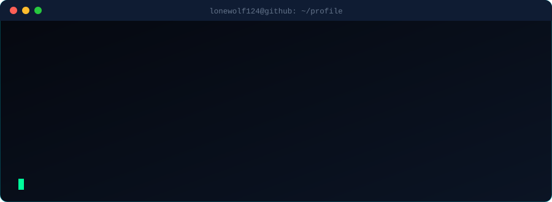

 

## `> cat about.md`

I'm a third-year B.Tech student (Cybersecurity and Digital Forensics, CGPA 9.0) working across the security lifecycle: finding weaknesses, detecting attacks, and managing the risk around them. I'm open to **SOC analyst, GRC and VAPT** roles and internships.

- **Detection and monitoring (SOC):** Wazuh + Sysmon detection lab on Azure, six attack techniques mapped to MITRE ATT&CK, a custom detection rule, incident reports and response playbooks. Splunk (SPL), SIEM, EDR, IDS/IPS and Wireshark.
- **Governance, risk and compliance (GRC):** ISO 27001 fundamentals, risk assessment, risk analysis and identification, risk registers, and risk-rated reporting with remediation guidance. SC-900 certified.
- **Offensive:** VAPT internship at Restaurant Brands Asia (Burger King India). 15 internal host ranges, 20+ assets, 20+ vulnerabilities reported (3 critical including 1 RCE). Active Directory misconfiguration testing.
- **Bug bounty:** 20+ programs on Intigriti and HackerOne, 3 Hall of Fame entries, a $100 bounty, Top 10 on HackerOne's Gogo VDP leaderboard.
- **Research:** co-authored a peer-reviewed paper (ICAMS 2025, Springer Nature) on secure data transfer with ECC + AES-256-GCM.
- **Community:** Technical Team Lead, WiCyS VIT Bhopal, supporting a 160+ participant hackathon.

## `> ls ./projects`

<table>
<tr>
<td width="50%" valign="top">

### Azure Wazuh SOC Detection Lab

Cloud SIEM with a Windows endpoint, six simulated attacks, real alert evidence, incident reports, playbooks and a **custom Wazuh rule (100100)** that I debugged live.

[**View the repo**](https://github.com/Lonewolf124/azure-wazuh-soc-lab)

</td>
<td width="50%" valign="top">

### Meta Hunter - VoIP Call Tracer

AI-powered fraud detection from network metadata, with a PCAP/NetFlow correlation engine. **Top 10 of 800+ teams** at the National CyberShield Hackathon.

[**View the repo**](https://github.com/Lonewolf124/Call_Hunters)

</td>
</tr>
<tr>
<td width="50%" valign="top">

### Secure AI Middleware (DLP) for GenAI

Redacts PII and secrets from ChatGPT/Claude prompts using regex with checksum validation plus a fine-tuned NER model. **95.14% recall, 89.66% F1, 45 ms** average latency on one CPU core. Team of 5, still being developed as our capstone.

[**View the repo**](https://github.com/Lonewolf124/Security-AI-Middleware-)

</td>
<td width="50%" valign="top">

### Secure Data Transfer using Network Coding

TCP/IP secure transfer system combining ECC key exchange with AES-256-GCM. **Published** and co-authored.

</td>
</tr>
</table>

## `> cat arsenal.txt`

## `> ./credentials.sh`

| Certification | Issuer | Status |
|---|---|---|
| **eJPTv2** Junior Penetration Tester | INE / eLearnSecurity | Certified |
| **AWS Certified Cloud Practitioner** (CLF-C02) | Amazon Web Services | Certified |
| **SC-900** Security, Compliance and Identity Fundamentals | Microsoft | Certified |
| **CEH v13** | EC-Council | Trained |
| **CompTIA Security+** | CompTIA | Exam scheduled |

<b>Experience and achievements (click to expand)</b>

 

| When | Role | Highlights |
|---|---|---|
| May - Jul 2026 | IT Intern, VAPT, Restaurant Brands Asia (Burger King India) | 15 internal host ranges and 20+ assets tested. 20+ findings (3 critical, 1 RCE, 9 high). 6 Active Directory misconfigurations such as weak ACLs. 20 red team and black-box scenarios with risk-rated reports. |
| Nov 2025 - now | Bug Hunter, Intigriti and HackerOne | 20+ programs tested. 20+ reports: IDOR, CSRF, broken access control, information disclosure, misconfigurations. |
| Feb 2025 - Feb 2026 | Technical Team Lead, WiCyS VIT Bhopal | Ran technical infrastructure and participant support for a 160+ participant hackathon. |

- Top 10 of 800+ teams, National CyberShield Hackathon (MP Police, SBI, Cleartrail Technologies)
- Top 10 of 300+ participants, HackCrux 2.0 (LNMIIT Jaipur)
- Top 5 on an Intigriti monthly private program, CTFtime India rank 73

## `> git log --stat`

 

